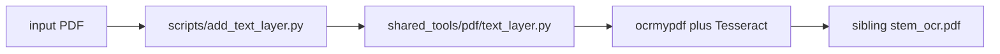

# OCR text layer CLI (ocrmypdf)

## What this is

A **standalone helper** for image-only (or mixed) PDFs: original page images stay, Tesseract boxes are sandwiched on as a searchable layer. **research-tools owns the tool.** marymachine can call it later (e.g. Verweij ~150 DPI book scans). That is a consumer, not a todo here.

Not the paper daemon. Scanner papers are 400–600 DPI with split/trim/border already in [scripts/paper_processor_daemon.py](../scripts/paper_processor_daemon.py). Do not wire this in.



**One engine.** ocrmypdf is the PDF pipeline that calls Tesseract (optional unpaper only if `--clean`). Do not merge EasyOCR/Paddle, do not copy Douglas overlay, do not use pytesseract `insert_text`.

Leave [scripts/ocr_pdf.py](../scripts/ocr_pdf.py) and [scripts/create_searchable_pdf.py](../scripts/create_searchable_pdf.py) behavior unchanged. README should say: use `add_text_layer.py` for searchable layers; `ocr_pdf.py` auto-rotates and silently falls back; `create_searchable_pdf.py` re-rasterizes.

## CLI

```
python scripts/add_text_layer.py INPUT.pdf
  [-o OUTPUT.pdf]
  [--pages 1-3|1,12,30]
  [--language eng]
  [--oversample 300]
  [--deskew | --no-deskew]
  [--clean]
  [--rotate]
  [--redo-ocr | --force-ocr]
  [--txt]
```

- Default output: `{stem}_ocr.pdf` next to input. **Never overwrite the source.** If `-o` equals the input path, exit with an error.
- `--pages`: pass through to ocrmypdf `--pages`. Do **not** slice with PyMuPDF (that would change the output page count). A 3-page experiment is `--pages 1-3` on the full file.
- `--oversample 300` (default): the 150 DPI lever. Harmless if the scan is already 300+.
- `--deskew` on by default (small skew). `--rotate` off by default (OSD has flipped whole books).
- `--clean` **off** by default. Unpaper can help noisy photocopies and can also damage thin strokes, footnotes, and hyphen dashes. Enable only after a visual/text check. If `--clean` is set and `unpaper` is missing, fail with a WSL/apt or conda hint — do not silently drop `--clean`.
- Existing text (ocrmypdf’s own model):
  - default: `--skip-text` (OCR pages that have no text; leave pages that already have a layer)
  - `--redo-ocr`: replace existing OCR-looking text
  - `--force-ocr`: rasterize/OCR every page
- `--output-type pdf` always (avoid Ghostscript PDF/A failures already seen in `ocr_pdf.py`).
- `--txt`: after a successful write, extract text from the **output** PDF (pymupdf) and dump `{output.stem}.txt` with end-of-line hyphen join only (`occur-\nring` → `occurring`). Not a second OCR path.

Fail clearly if `ocrmypdf`, `tesseract`, or `gs` are missing. No pytesseract/`insert_text` fallback.

## Library layout

Match [shared_tools/pdf/](../shared_tools/pdf/):

- [shared_tools/pdf/text_layer.py](../shared_tools/pdf/text_layer.py) — `check_dependencies()`, `add_text_layer(...)`, hyphen-join helper, argv builder. Do **not** import in [shared_tools/pdf/__init__.py](../shared_tools/pdf/__init__.py) (keep that file’s optional-import style; this module has no OpenCV).
- [scripts/add_text_layer.py](../scripts/add_text_layer.py) — argparse only; `sys.path` to project root like other scripts.

Core call:

```text
ocrmypdf --language LANG --output-type pdf --oversample 300
  --skip-text   # or --redo-ocr / --force-ocr
  --deskew      # unless --no-deskew
  [--clean] [--rotate-pages]
  [--pages RANGE]
  INPUT OUTPUT
```

## Environment

Pin what Windows conda actually has; do not require unpaper.

Add to [environment.yml](../environment.yml) (conda-forge): `ocrmypdf`, `tesseract`, `ghostscript`. Keep `pytesseract` for existing book-ISBN/rotation code.

**unpaper is optional** and usually Linux-only. If `--clean` is needed, run from WSL `research-tools` (`conda install` or `sudo apt install unpaper`). Do not make unpaper a win-64 hard dependency; this repo already dropped unpaper for borders because it was slower and extra native deps.

Document in README: conda `research-tools` / `research-tools-win` **or** `.venv-win` plus those binaries on PATH. Prefer whichever env already has the three required binaries.

## Tests

[tests/test_ocr_text_layer.py](../tests/test_ocr_text_layer.py) — pymupdf synthetic PDFs, **mock** `subprocess.run` (no Tesseract in CI).

- Refuses to write onto the input path.
- Default argv includes `--oversample 300`, `--skip-text`, `--output-type pdf`, `--deskew`, and does **not** include `--clean` or `--rotate-pages`.
- `--clean` adds `--clean`; `--rotate` adds `--rotate-pages`; `--redo-ocr` / `--force-ocr` replace `--skip-text`; `--pages 1-3` is passed through.
- `--txt` hyphen-join: `occur-\nring` → `occurring` on a tiny PDF with that text.
- Missing `ocrmypdf`/`tesseract`/`gs` raises a clear error; `--clean` without `unpaper` raises only when `--clean` is requested.

No live Verweij (or other book) run in this repo. marymachine can call the CLI later.

## Docs

- Short README subsection under helper scripts: command, sibling output, skip/redo/force, `--clean` optional / WSL.
- [shared_tools/pdf/README.md](../shared_tools/pdf/README.md): one paragraph + import example.

## Out of scope

Daemon, GROBID, Zotero, marymachine code, editing `ocr_pdf.py` / `create_searchable_pdf.py`, auto-split, auto-rotate, committing PDFs, merging OCR engines, Douglas overlay.
